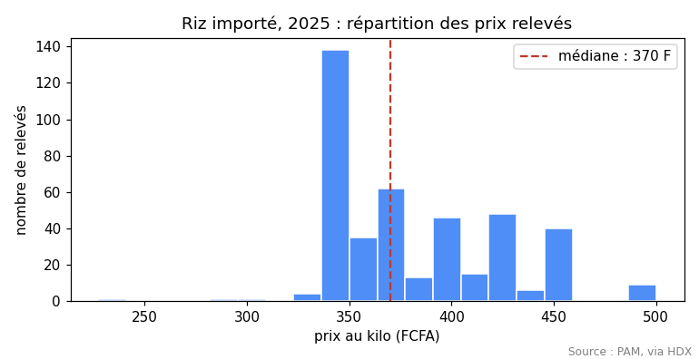
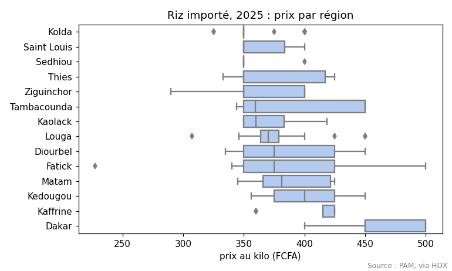
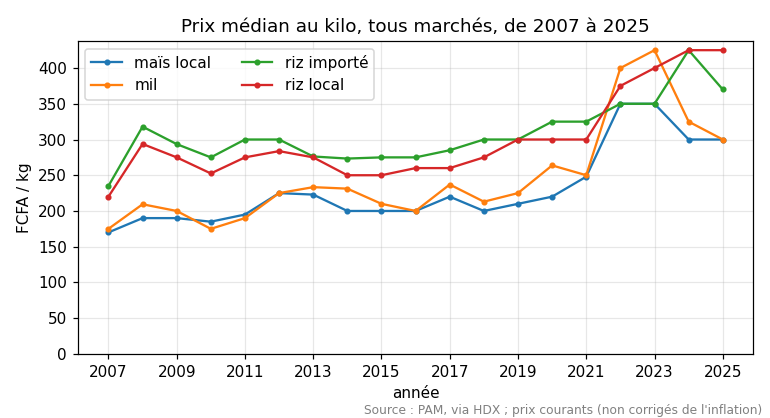
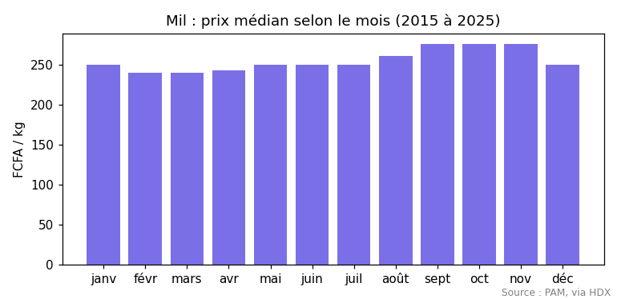
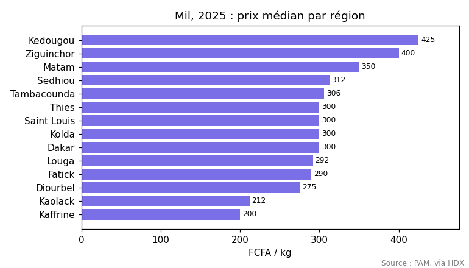
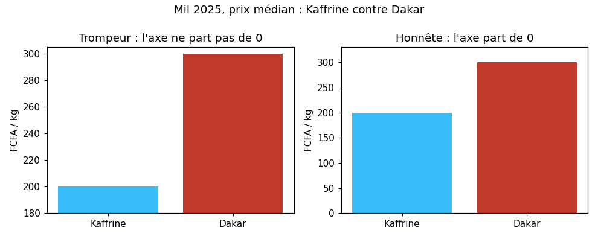
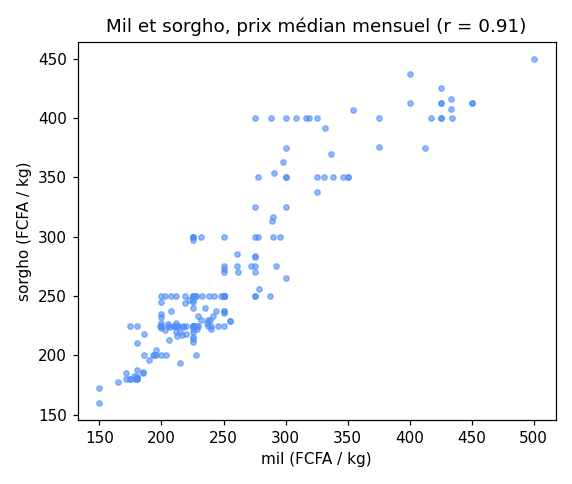
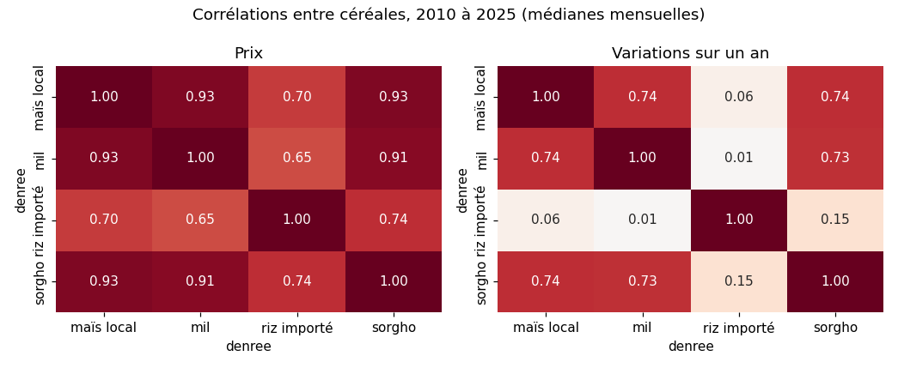
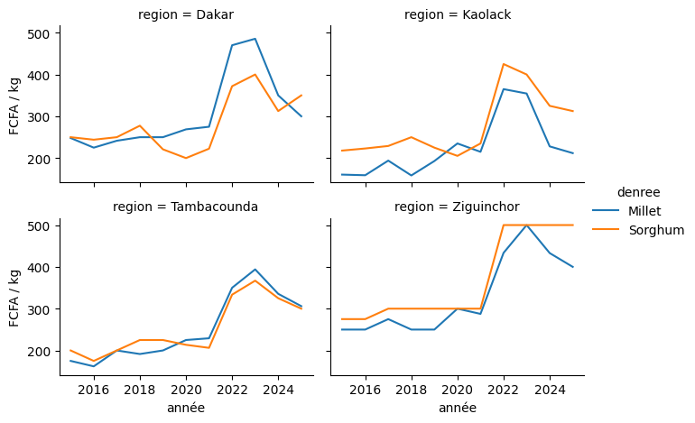

<div class="bandeau"></div>

# Chapitre 6 : Explorer et montrer : statistiques, graphiques et conclusions

<p class="auteur">Par <strong>Robert DIASSÉ</strong>, Ingénieur Logiciel et Data</p>

> **Cours** : Python pour la science des données · **Fil rouge** : les prix des denrées sur les marchés du Sénégal · **Version** : 2026-10-31

## Fiche du chapitre

| | |
|---|---|
| **Objectifs (OS5)** | A la fin du chapitre, l'apprenant sait : 1) résumer une variable (moyenne, médiane, quartiles, écart-type, coefficient de variation) et repérer les valeurs atypiques ; 2) choisir le bon graphique pour une question (distribution, évolution, comparaison, relation) ; 3) construire un graphique propre avec matplotlib (titre, axes et unités, légende, source) et l'enregistrer ; 4) utiliser seaborn pour les graphiques statistiques (boîtes, carte de chaleur, petits multiples) ; 5) calculer et lire une corrélation, sans la confondre avec une cause ; 6) éviter les graphiques trompeurs ; 7) rédiger des conclusions chiffrées et prudentes ; 8) utiliser un assistant d'IA de façon critique ; 9) situer la suite : la programmation orientée objet. |
| **Prérequis** | Chapitres 1 à 5 |
| **Durée** | 🟢 Débutant : 8 h · 🔵 Standard : 6 h · 🟣 Expert : 4 h (sans le mini-projet) |
| **Matériel** | Google Colab ; les relevés du PAM (déjà fournis) ; matplotlib et seaborn sont déjà installés dans Colab |
| **Livrable** | Le mini-projet : une analyse exploratoire complète, en notebook, présentée à l'oral |

### Comment lire ce chapitre

- **Noyau** : obligatoire pour tous les niveaux.
- 🟢 **Débutant** : explications pas à pas.
- 🔵 **Standard** : le niveau de référence.
- 🟣 **Expert** : approfondissements.

Ouvrez un nouveau notebook Colab, `chapitre6-exploration`, envoyez-y le fichier des prix du PAM, et tapez les exemples dans l'ordre. Les résultats affichés ont été obtenus avec pandas 2 ; dans un Colab récent (pandas 3), les **valeurs** sont les mêmes, mais l'affichage peut différer légèrement (nombre de décimales, alignement).

---

## 1. Explorer avant de conclure

Une **analyse exploratoire** (en anglais *EDA*, *Exploratory Data Analysis*) consiste à **regarder** les données sous tous les angles avant d'affirmer quoi que ce soit : leur forme, leurs valeurs typiques, leurs valeurs bizarres, leur évolution, leurs liens. C'est l'étape qui suit le nettoyage (chapitre 4) et l'agrégation (chapitre 5), et qui précède toute conclusion ou tout modèle (le cours de Machine Learning).

Elle suit toujours le même cycle : **une question, un calcul, un graphique, une phrase**. Par exemple :

| Question | Calcul | Graphique | Phrase |
|---|---|---|---|
| Combien coûte le riz importé en 2025 ? | Médiane, quartiles | Histogramme | « La moitié des relevés sont entre 350 et 416 F/kg. » |
| Où est-il le plus cher ? | Médiane par région | Boîtes par région | « Dakar est la région la plus chère (450 F/kg). » |
| Comment le prix a-t-il évolué ? | Médiane par année | Courbe | « Le mil a doublé de 2021 à 2023, puis a baissé. » |
| Le mil et le sorgho bougent-ils ensemble ? | Corrélation | Nuage de points | « Leurs prix sont très liés (r = 0,91). » |

## 2. Préparer les relevés

```python
import pandas as pd
import matplotlib.pyplot as plt
import seaborn as sns

prix = pd.read_csv("wfp_food_prices_sen.csv")
prix = prix[prix["unit"] == "KG"].copy()
prix = prix[["date", "admin1", "market", "commodity", "price"]]
prix = prix.rename(columns={"admin1": "region", "market": "marche", "commodity": "denree", "price": "prix"})
prix["date"] = pd.to_datetime(prix["date"])
prix["annee"] = prix["date"].dt.year
prix["mois"] = prix["date"].dt.month
print(prix.shape)
```

```text
(51854, 7)
```

| Morceau | Ce qu'il veut dire |
|---|---|
| `import matplotlib.pyplot as plt` | La bibliothèque de graphiques de base de Python ; `plt` est l'abréviation que tout le monde utilise |
| `import seaborn as sns` | Une bibliothèque construite **sur** matplotlib, spécialisée dans les graphiques statistiques ; `sns` est l'abréviation d'usage |
| Le reste | Les gestes du chapitre 5 : prix au kilo, colonnes renommées, date convertie, année et mois |

## 3. Résumer une variable

### 3.1 Les statistiques de base

```python
riz25 = prix[(prix["denree"] == "Rice (imported)") & (prix["annee"] == 2025)]
riz25["prix"].describe().round(1)
```

```text
count    419.0
mean     384.4
std       39.9
min      227.5
25%      350.0
50%      370.0
75%      415.8
max      500.0
Name: prix, dtype: float64
```

| Ligne | Ce qu'elle veut dire, ici |
|---|---|
| `count` | 419 relevés de riz importé en 2025 |
| `mean` | La **moyenne** : 384,4 F/kg |
| `50%` | La **médiane** : la moitié des relevés sont en dessous de 370 F, l'autre moitié au-dessus |
| `25%` et `75%` | Le **premier** et le **troisième quartile** (Q1, Q3) : la moitié **centrale** des relevés est entre 350 et 415,8 F |
| `std` | L'**écart-type** : la dispersion moyenne autour de la moyenne, environ 40 F |
| `min`, `max` | Les extrêmes : 227,5 F et 500 F |

> 🟢 **Débutant : moyenne ou médiane ?**
> La moyenne est tirée par les valeurs extrêmes ; la médiane, non. Ici la moyenne (384,4) est au-dessus de la médiane (370) : quelques relevés très chers tirent la moyenne vers le haut. Pour des **prix**, des **salaires** ou des **durées**, la médiane décrit mieux « le cas typique ». C'est pour cela que les chapitres précédents utilisaient déjà la médiane.

### 3.2 Comparer des groupes : le coefficient de variation

```python
par_region = (riz25.groupby("region")["prix"]
              .agg(releves="size", mediane="median", moyenne="mean", ecart_type="std")
              .round(1).sort_values("mediane"))
par_region["cv_%"] = (100 * par_region["ecart_type"] / par_region["moyenne"]).round(1)
par_region
```

```text
             releves  mediane  moyenne  ecart_type  cv_%
region
Kolda             27    350.0    358.3        21.9   6.1
Saint Louis       20    350.0    364.2        21.1   5.8
Sedhiou            6    350.0    358.3        20.4   5.7
Thies             36    350.0    373.0        35.7   9.6
Ziguinchor        21    350.0    365.4        28.7   7.9
Tambacounda       48    359.4    387.9        45.7  11.8
Kaolack           45    360.0    369.5        21.0   5.7
Louga             30    370.0    375.6        29.2   7.8
Diourbel          40    375.0    385.6        39.8  10.3
Fatick            46    375.0    386.8        45.6  11.8
Matam             34    381.2    388.5        27.2   7.0
Kedougou          31    400.0    403.7        29.9   7.4
Kaffrine          13    415.0    410.4        22.9   5.6
Dakar             22    450.0    458.5        36.9   8.0
```

| Morceau | Ce qu'il veut dire |
|---|---|
| `cv_%` | Le **coefficient de variation** : l'écart-type rapporté à la moyenne, en %. Il permet de comparer la dispersion de groupes dont les prix n'ont pas le même niveau |
| Tambacounda et Fatick : 11,8 % | Les prix y varient le plus d'un relevé à l'autre |
| Sédhiou : 6 relevés | Attention : une médiane calculée sur 6 relevés est **fragile**. Gardez toujours la colonne du **nombre** de relevés à côté d'une statistique |

### 3.3 Les valeurs atypiques

La règle la plus utilisée (celle des boîtes à moustaches, section 4.2) : une valeur est **atypique** si elle est à plus de 1,5 fois l'**écart interquartile** (IQR = Q3 - Q1) en dessous de Q1 ou au-dessus de Q3.

```python
q1, q3 = riz25["prix"].quantile([0.25, 0.75])
iqr = q3 - q1
bas, haut = q1 - 1.5 * iqr, q3 + 1.5 * iqr
atypiques = riz25[(riz25["prix"] < bas) | (riz25["prix"] > haut)]
print(round(bas, 1), round(haut, 1), len(atypiques))
atypiques[["date", "region", "marche", "prix"]]
```

```text
251.2 514.6 1
            date  region   marche   prix
45832 2025-04-15  Fatick  Diakhao  227.5
```

Un seul relevé est atypique : 227,5 F/kg à Diakhao en avril 2025, bien moins cher que tous les autres. **Atypique ne veut pas dire faux** : avant de le retirer, on se demande s'il s'agit d'une erreur de saisie, d'un autre produit (une autre qualité de riz), ou d'une vraie bonne affaire. Dans le doute, on le garde, on le **signale**, et on préfère la médiane, qu'il ne perturbe pas.

## 4. Montrer une distribution

### 4.1 L'histogramme, avec matplotlib

```python
fig, ax = plt.subplots(figsize=(7, 3.6))
ax.hist(riz25["prix"], bins=20, color="#4f8ef7", edgecolor="white")
ax.axvline(riz25["prix"].median(), color="#c0392b", linestyle="--",
           label=f"médiane : {riz25['prix'].median():.0f} F")
ax.set_title("Riz importé, 2025 : répartition des prix relevés")
ax.set_xlabel("prix au kilo (FCFA)")
ax.set_ylabel("nombre de relevés")
ax.legend()
fig.text(0.99, 0.01, "Source : PAM, via HDX", ha="right", fontsize=8, color="gray")
fig.tight_layout()
fig.savefig("histogramme_riz.png", dpi=110)
plt.show()
```



| Morceau | Ce qu'il veut dire |
|---|---|
| `fig, ax = plt.subplots(figsize=(7, 3.6))` | Crée une **figure** (la page, ici 7 pouces sur 3,6) et un **axe** (la zone de dessin). Toutes les commandes suivantes passent par `ax` |
| `ax.hist(..., bins=20)` | L'**histogramme** : les prix sont rangés en 20 intervalles, et la hauteur de chaque barre est le nombre de relevés dans l'intervalle |
| `ax.axvline(...)` | Une ligne verticale, ici à la médiane |
| `set_title`, `set_xlabel`, `set_ylabel` | Le titre et les axes, **avec l'unité**. Un graphique sans unité ne veut rien dire |
| `fig.text(..., "Source : ...")` | La **source** des données, en petit : obligatoire dès qu'un graphique sort du notebook |
| `fig.tight_layout()` | Ajuste les marges pour que rien ne soit coupé |
| `fig.savefig("...png", dpi=110)` | Enregistre l'image (pour un rapport ou des diapositives) ; `dpi` règle la finesse |
| `plt.show()` | Affiche la figure dans le notebook |

On lit : la plupart des relevés sont entre 340 et 420 F ; il y a un « paquet » de 49 relevés entre 450 et 500 F (dont 17 des 22 relevés de Dakar, voir la section suivante) et une valeur isolée à gauche (Diakhao).

### 4.2 Comparer des distributions : la boîte à moustaches, avec seaborn

```python
ordre = par_region.index.tolist()
fig, ax = plt.subplots(figsize=(7, 4.2))
sns.boxplot(data=riz25, x="prix", y="region", order=ordre, color="#a9c8fb", ax=ax)
ax.set_title("Riz importé, 2025 : prix par région")
ax.set_xlabel("prix au kilo (FCFA)")
ax.set_ylabel("")
plt.show()
```



| Élément de la boîte | Ce qu'il montre |
|---|---|
| Le trait dans la boîte | La médiane |
| Les bords de la boîte | Q1 et Q3 : la moitié centrale des relevés |
| Les moustaches | Jusqu'aux valeurs les plus éloignées qui ne sont **pas** atypiques (1,5 IQR) |
| Les points isolés | Les valeurs atypiques **de chaque région** |

| Morceau | Ce qu'il veut dire |
|---|---|
| `sns.boxplot(data=riz25, x="prix", y="region", ...)` | seaborn travaille directement sur un tableau pandas : on donne le tableau et les **noms** des colonnes |
| `order=ordre` | Les régions dans l'ordre de leur médiane (le tableau de la section 3.2) : le graphique se lit de haut en bas, du moins cher au plus cher |
| `ax=ax` | seaborn dessine dans l'axe préparé avec matplotlib, que l'on peut ensuite titrer comme d'habitude |

En une image : Dakar est nettement plus cher que toutes les autres régions ; Kaffrine et Kédougou suivent ; Fatick et Tambacounda ont les boîtes les plus étalées (leur coefficient de variation était le plus grand).

## 5. Montrer une évolution

### 5.1 La courbe

```python
denrees = {"Rice (imported)": "riz importé", "Rice (local)": "riz local", "Millet": "mil", "Maize (local)": "maïs local"}
evol = (prix[prix["denree"].isin(denrees) & prix["annee"].between(2007, 2025)]
        .groupby(["annee", "denree"])["prix"].median().unstack().rename(columns=denrees))

fig, ax = plt.subplots(figsize=(7, 3.8))
for colonne in evol.columns:
    ax.plot(evol.index, evol[colonne], marker="o", markersize=3, label=colonne)
ax.set_title("Prix médian au kilo, tous marchés, de 2007 à 2025")
ax.set_xticks(range(2007, 2026, 2))
ax.set_xlabel("année")
ax.set_ylabel("FCFA / kg")
ax.set_ylim(0, None)
ax.legend(ncol=2)
ax.grid(alpha=0.3)
plt.show()
```



| Morceau | Ce qu'il veut dire |
|---|---|
| `.unstack()` | Le résultat du `groupby` passe en format large : une ligne par année, une colonne par denrée (chapitre 5) |
| `ax.plot(x, y, marker="o", label=...)` | Une **courbe** par denrée ; les petits ronds marquent chaque année, `label` sert à la légende |
| `ax.set_xticks(range(2007, 2026, 2))` | Une graduation toutes les deux années (sinon, matplotlib affiche des années à virgule, comme 2007,5) |
| `ax.set_ylim(0, None)` | L'axe vertical part de **zéro** (voir la section 6.2) |
| `ax.grid(alpha=0.3)` | Une grille légère, pour lire les valeurs |

Quelques valeurs pour lire la courbe :

```text
denree  maïs local    mil  riz importé  riz local
annee
2007         170.0  175.0        235.0      220.0
2008         190.0  209.0        318.0      294.0
2021         248.0  250.0        325.0      300.0
2022         350.0  400.0        350.0      375.0
2023         350.0  425.0        350.0      400.0
2025         300.0  300.0        370.0      425.0
```

On voit deux chocs : 2008 (la crise mondiale des prix alimentaires, surtout sur le riz importé, +35 % en un an) et 2022-2023 (le mil passe de 250 à 425 F/kg, puis redescend à 300 F en 2025). Ces prix sont **courants** (ils ne sont pas corrigés de l'inflation) : une partie de la hausse sur vingt ans vient simplement de la hausse générale des prix.

### 5.2 La saisonnalité

```python
mil = prix[(prix["denree"] == "Millet") & prix["annee"].between(2015, 2025)]
profil = mil.groupby("mois")["prix"].median()
fig, ax = plt.subplots(figsize=(7, 3.4))
ax.bar(profil.index, profil.values, color="#7b6fe8")
ax.set_xticks(range(1, 13), ["janv", "févr", "mars", "avr", "mai", "juin", "juil", "août", "sept", "oct", "nov", "déc"])
ax.set_title("Mil : prix médian selon le mois (2015 à 2025)")
ax.set_ylabel("FCFA / kg")
ax.set_ylim(0, None)
plt.show()
```



Le prix médian du mil est de 240 à 250 F/kg de janvier à juillet, monte à 260 F en août, puis à 275 F de septembre à novembre, avant de redescendre à 250 F en décembre, après la récolte. C'est la **soudure** (vue au chapitre 5) : la période où les greniers de la récolte précédente se vident. L'écart (environ 10 %) est réel mais modeste à l'échelle nationale ; il est plus marqué dans certaines régions.

## 6. Comparer des groupes, honnêtement

### 6.1 Le diagramme en barres

```python
mil25 = (prix[(prix["denree"] == "Millet") & (prix["annee"] == 2025)]
         .groupby("region")["prix"].median().sort_values())
fig, ax = plt.subplots(figsize=(7, 4))
ax.barh(mil25.index, mil25.values, color="#7b6fe8")
ax.set_title("Mil, 2025 : prix médian par région")
ax.set_xlabel("FCFA / kg")
for y, v in enumerate(mil25.values):
    ax.text(v + 3, y, f"{v:.0f}", va="center", fontsize=8)
ax.set_xlim(0, mil25.max() * 1.12)
plt.show()
```



| Morceau | Ce qu'il veut dire |
|---|---|
| `ax.barh(...)` | Des barres **horizontales** : les noms de régions se lisent sans pencher la tête |
| `.sort_values()` | Les barres **triées** : le classement se voit d'un coup d'œil |
| `ax.text(...)` dans la boucle | La valeur écrite au bout de chaque barre |

Le mil est le moins cher dans le bassin arachidier (Kaffrine 200 F, Kaolack 212 F), là où il est cultivé, et le plus cher au sud et à l'est (Ziguinchor 400 F, Kédougou 425 F).

### 6.2 Le piège de l'axe qui ne part pas de zéro



Les deux graphiques montrent **les mêmes chiffres** : 200 F à Kaffrine, 300 F à Dakar, soit 50 % de plus. Avec un axe qui commence à 180, la barre de Dakar paraît **six fois** plus haute ; avec un axe qui part de zéro, elle est 1,5 fois plus haute, comme le prix. **La longueur d'une barre doit être proportionnelle à la valeur** : l'axe d'un diagramme en barres part toujours de zéro. (Pour une **courbe**, on peut zoomer, à condition de le dire.)

**Autres pièges à éviter**

| Piège | Pourquoi c'est trompeur | A la place |
|---|---|---|
| Camembert de 14 parts | L'œil compare mal les angles | Barres triées |
| Effets 3D, ombres | Ils déforment les longueurs | Graphique plat |
| Deux axes verticaux différents sur une courbe | On peut faire « se croiser » n'importe quelles courbes | Deux graphiques, ou des indices base 100 (chapitre 3) |
| Couleurs sans sens (arc-en-ciel) | Elles suggèrent un ordre qui n'existe pas | Une couleur, sauf si la couleur porte une information |
| Pas de source, pas d'unité, pas de date | On ne peut ni vérifier ni comprendre | Titre, unités, période, source |

## 7. Relier deux variables : la corrélation

### 7.1 Le nuage de points et le coefficient de corrélation

Le mil et le sorgho, deux céréales locales cultivées dans les mêmes zones, ont-ils des prix liés ? On calcule le prix médian **national** de chaque mois, puis on compare.

```python
cereales = {"Millet": "mil", "Sorghum": "sorgho", "Maize (local)": "maïs local", "Rice (imported)": "riz importé"}
mensuel = (prix[prix["denree"].isin(cereales) & prix["annee"].between(2010, 2025)]
           .groupby([pd.Grouper(key="date", freq="MS"), "denree"])["prix"].median()
           .unstack().rename(columns=cereales).dropna())
print(len(mensuel))
mensuel.corr().round(2)
```

```text
191
denree       maïs local   mil  riz importé  sorgho
denree
maïs local         1.00  0.93         0.70    0.93
mil                0.93  1.00         0.65    0.91
riz importé        0.70  0.65         1.00    0.74
sorgho             0.93  0.91         0.74    1.00
```

| Morceau | Ce qu'il veut dire |
|---|---|
| `pd.Grouper(key="date", freq="MS")` | Regroupe les dates **par mois** (`MS` : *month start*, le début du mois) |
| `.dropna()` | Ne garde que les 191 mois où les quatre céréales ont un prix |
| `.corr()` | La **matrice de corrélation** : le coefficient de Pearson `r` entre chaque paire de colonnes |
| `r` | Entre -1 et 1. Près de 1 : quand l'un monte, l'autre monte aussi, de façon régulière. Près de 0 : pas de lien **linéaire**. Près de -1 : quand l'un monte, l'autre baisse |



Le nuage du mil et du sorgho est presque une droite montante : r = 0,91.

### 7.2 Corrélation n'est pas causalité, et la tendance commune

Toutes les corrélations du tableau sont fortes, même celle du riz **importé** (qui vient d'Asie, par bateau) avec le mil (cultivé au Sénégal) : 0,65. Le riz importé ferait-il monter le mil ? Pas forcément : sur quinze ans, **tous** les prix montent (inflation, coût du transport, hausse de la demande). Deux séries qui montent toutes les deux sont corrélées, même sans aucun lien direct.

Pour retirer cette **tendance commune**, on compare les **variations** : de combien le prix a-t-il changé par rapport au même mois de l'année précédente ?

```python
variations = mensuel.pct_change(12).dropna()
variations.corr().round(2)
```

```text
denree       maïs local   mil  riz importé  sorgho
denree
maïs local         1.00  0.74         0.06    0.74
mil                0.74  1.00         0.01    0.73
riz importé        0.06  0.01         1.00    0.15
sorgho             0.74  0.73         0.15    1.00
```



| Morceau | Ce qu'il veut dire |
|---|---|
| `pct_change(12)` | La variation en pourcentage par rapport à **12 lignes plus haut**, c'est-à-dire au même mois de l'année précédente (une ligne par mois) |
| `sns.heatmap(..., annot=True, vmin=-1, vmax=1, cmap="RdBu_r")` | La **carte de chaleur** de la figure : une case par paire, colorée selon `r`, avec la valeur écrite |

Les variations des trois céréales **locales** restent liées (r autour de 0,74) : une mauvaise récolte les touche toutes. Mais celles du riz importé n'ont **presque plus aucun lien** avec le mil (0,01) : la corrélation de 0,65 venait de la tendance commune. Conclusion prudente : le riz importé et le mil évoluent ensemble sur le long terme, mais **rien n'indique** que l'un fasse varier l'autre d'une année sur l'autre.

> 🔵 **Standard : ce qu'une corrélation ne dit pas**
> 1) Elle ne dit pas **qui** cause **quoi** (ni même s'il y a une cause). 2) Elle ne mesure que les liens **linéaires** (un lien en forme de U peut donner r = 0). 3) Elle est très sensible aux valeurs **atypiques**. Regardez toujours le **nuage de points** avant de citer un `r`.

## 8. seaborn : un graphique par groupe, en une ligne

Pour comparer la même évolution dans plusieurs régions, on dessine des **petits multiples** : un petit graphique par région, avec les mêmes axes.

```python
choix = prix[prix["denree"].isin(["Millet", "Sorghum"]) & prix["annee"].between(2015, 2025)
             & prix["region"].isin(["Dakar", "Kaolack", "Tambacounda", "Ziguinchor"])]
g = sns.relplot(data=choix, x="annee", y="prix", hue="denree", col="region", col_wrap=2, kind="line",
                estimator="median", errorbar=None, height=2.4, aspect=1.4)
g.set_axis_labels("année", "FCFA / kg")
plt.show()
```



| Morceau | Ce qu'il veut dire |
|---|---|
| `sns.relplot(..., kind="line")` | Une courbe de `y` selon `x` |
| `hue="denree"` | Une couleur par denrée |
| `col="region", col_wrap=2` | Un graphique par région, deux par ligne |
| `estimator="median", errorbar=None` | Pour chaque année, la **médiane** des relevés, sans bande d'incertitude |

On voit que le choc de 2022 touche les quatre régions ; à Ziguinchor, le sorgho reste à 500 F/kg de 2022 à 2025, alors que le mil redescend à 400 F.

> 🟢 **Débutant : matplotlib ou seaborn ?**
> seaborn pour **explorer** vite (boîtes, cartes de chaleur, petits multiples, couleurs par groupe en un argument) ; matplotlib pour **régler** chaque détail d'un graphique final. On mélange souvent les deux : seaborn dessine, matplotlib titre et enregistre.

## 9. Conclure : des phrases chiffrées et prudentes

Un graphique ne parle pas tout seul. Chaque graphique du notebook est suivi d'une cellule de texte qui dit **ce qu'on y voit**, avec des chiffres, et **jusqu'où** on peut aller.

| Conclusion faible | Conclusion utile |
|---|---|
| « Les prix sont chers à Dakar. » | « En 2025, le riz importé coûte 450 F/kg à Dakar (médiane de 22 relevés), contre 350 F dans cinq régions, soit 29 % de plus. » |
| « Le mil a beaucoup augmenté. » | « Le prix médian du mil est passé de 250 F/kg en 2021 à 425 F en 2023 (+70 %), puis est redescendu à 300 F en 2025. » |
| « Le riz fait monter le mil. » | « Les prix du riz importé et du mil sont corrélés sur 15 ans (r = 0,65), mais leurs variations annuelles ne le sont pas (r = 0,01) : la corrélation vient surtout de la hausse générale des prix. » |

**Les limites à toujours écrire**

- **Couverture** : tous les marchés ne sont pas suivis tous les mois (chapitre 5 : 34 marchés non suivis en 2025) ; une médiane sur peu de relevés est fragile.
- **Prix courants** : non corrigés de l'inflation.
- **Données de 2026** : l'année n'est pas finie (relevés jusqu'en juillet).
- **Corrélation** : jamais présentée comme une cause.
- **Source** : « World Food Programme, via HDX », licence CC BY-IGO.

## 10. L'IA avec esprit critique

Les assistants d'IA (ChatGPT, Claude, Gemini...) écrivent très vite du code pandas et matplotlib. Ils sont utiles pour retrouver une syntaxe ou un nom de paramètre, et pour proposer un premier graphique. Mais ils se trompent souvent sur ce qui compte le plus en analyse de données :

| L'IA a tendance à... | Ce que vous vérifiez |
|---|---|
| Inventer des noms de colonnes (`price_xof`, `region_name`) | `prix.columns` : les vrais noms |
| Calculer une **moyenne** là où la médiane convient | Le choix de la statistique, et sa justification |
| Proposer des camemberts, des axes tronqués, des couleurs inutiles | La section 6.2 |
| Conclure à une **cause** à partir d'une corrélation | La section 7.2 |
| Écrire des conclusions avec des chiffres **qu'elle n'a pas calculés** | Chaque chiffre de vos conclusions vient d'une cellule de **votre** notebook |
| Utiliser des fonctions d'une autre version de pandas | Exécuter le code, lire les avertissements |

**Les règles du cours** : vous comprenez chaque ligne que vous rendez ; chaque chiffre de vos conclusions sort de votre notebook ; vous ne collez jamais dans une IA de données personnelles ou confidentielles (ici, les données du PAM sont publiques) ; vous indiquez, dans une cellule à la fin du notebook, l'aide que vous avez reçue et comment vous l'avez vérifiée.

## 11. Et ensuite : la programmation orientée objet

Vous utilisez des **objets** depuis le chapitre 1 : un `DataFrame` est un objet, qui **contient** des données (les colonnes) et **sait faire** des choses (`prix.groupby(...)`, `prix.describe()`). `fig` et `ax` sont des objets matplotlib : `ax.set_title(...)` appelle une **méthode** de l'objet `ax`. La programmation orientée objet consiste à écrire **vos propres** classes de ce genre : par exemple une classe `Marche` qui connaîtrait ses relevés et saurait calculer son indice de cherté. C'est la suite de votre parcours en Python.

## Exercices

Travaillez dans un notebook `exercices-ch6`, sur les relevés préparés à la section 2.

- ★ **Exercice 1 : le niébé en 2025.** Résumez le prix du niébé (`Beans (niebe)`) en 2025 : nombre de relevés, moyenne, médiane, quartiles, écart-type. Calculez les bornes des valeurs atypiques (règle 1,5 IQR) et comptez-les. Tracez l'histogramme avec la médiane. Écrivez deux phrases de conclusion. (Sections 3 et 4.) Valeurs attendues : 376 relevés, médiane 879,2 F, Q1 719,7 F, Q3 1000 F, aucune valeur atypique.
- ★ **Exercice 2 : l'arachide en coque et décortiquée.** Tracez, sur un même graphique, le prix médian annuel de l'arachide décortiquée (`Groundnuts (shelled)`) et en coque (`Groundnuts (unshelled)`) de 2020 à 2026, avec une graduation par année et un axe qui part de zéro. Que remarquez-vous en 2022-2023 ? Pourquoi faut-il signaler la valeur de 2026 ? (Section 5.)
- ★★ **Exercice 3 : le maïs local en 2024.** Dessinez les boîtes à moustaches du prix du maïs local en 2024 par région, triées par médiane. Quelle région est la moins chère, laquelle la plus chère ? Quelles régions ont les prix les plus **dispersés** (calculez l'écart interquartile par région) ? (Sections 3 et 4.2.)
- ★★ **Exercice 4 : riz importé et riz local.** Sur les prix médians mensuels nationaux de 2010 à 2025, calculez la corrélation entre le riz importé et le riz local, puis celle de leurs variations sur un an. Dessinez le nuage de points. Rédigez une conclusion prudente (trois phrases au plus). (Section 7.)
- ★★★ **Exercice 5 : critiquer un graphique proposé par une IA.** On a demandé à une IA « un graphique des prix du mil par région en 2025 ». Elle propose : un **camembert** des prix moyens (`plt.pie`), sans titre ni unité, puis un diagramme en barres dont l'axe vertical commence à 190, avec la phrase « le mil est deux fois plus cher à Kédougou qu'à Kaolack, à cause de l'éloignement ». a) Listez tous les problèmes (graphique, statistique, conclusion) ; b) vérifiez le « deux fois plus cher » avec vos propres calculs (médianes) ; c) produisez le graphique correct et une conclusion honnête. (Sections 6, 9 et 10.)

## Mini-projet : une analyse exploratoire complète

Le travail final du cours : en binôme, vous choisissez une question sur les prix des marchés du Sénégal, vous menez toute la démarche (chargement, nettoyage, agrégation, statistiques, graphiques, conclusions) dans un notebook, et vous la présentez à l'oral. L'énoncé vous est fourni séparément.

## A retenir

- Explorer : **une question, un calcul, un graphique, une phrase**.
- `describe()` : nombre, moyenne, médiane (50 %), quartiles, écart-type, extrêmes. Pour des prix, la **médiane**. Toujours le **nombre** de relevés à côté d'une statistique ; le coefficient de variation pour comparer des dispersions.
- Valeurs atypiques : au-delà de 1,5 × IQR de Q1 ou Q3 ; atypique ne veut pas dire faux.
- Distribution : histogramme, boîte à moustaches ; évolution : courbe ; comparaison : barres triées (axe à zéro) ; relation : nuage de points ; corrélations : carte de chaleur ; groupes : petits multiples.
- matplotlib : `fig, ax = plt.subplots()`, `ax.plot / bar / barh / hist / scatter`, titre, axes avec unités, légende, source, `fig.savefig`. seaborn : `boxplot`, `heatmap`, `relplot`, à partir d'un `DataFrame`.
- `corr()` : r entre -1 et 1 ; corrélation n'est pas causalité ; retirer la tendance commune en comparant les **variations** ; regarder le nuage.
- Conclusions chiffrées, avec leurs limites et la source ; aucun chiffre qui ne sorte du notebook.

## Erreurs fréquentes

| Erreur ou symptôme | Ce que ça veut dire | Solution |
|---|---|---|
| Rien ne s'affiche, ou deux graphiques se superposent | Pas de `plt.show()`, ou deux graphiques dans la même figure | Une figure (`plt.subplots`) par graphique, puis `plt.show()` |
| Des années à virgule sur l'axe (2007,5) | matplotlib choisit les graduations | `ax.set_xticks(...)` avec des entiers |
| Étiquettes coupées dans l'image enregistrée | Marges trop petites | `fig.tight_layout()` avant `savefig` |
| `KeyError: 'Prix'` dans un graphique seaborn | Nom de colonne mal écrit (majuscule) | Vérifier `prix.columns` |
| Une moyenne tirée par quelques valeurs extrêmes | Mauvaise statistique pour des prix | La médiane |
| Des barres qui exagèrent les écarts | L'axe ne part pas de zéro | `ax.set_ylim(0, None)` |
| « r = 0,9, donc A cause B » | Confusion corrélation et causalité | Parler de lien, chercher une tendance commune, comparer les variations |
| Une médiane étonnante pour une région | Calculée sur très peu de relevés | Afficher le nombre de relevés ; le dire dans la conclusion |

## Pour aller plus loin

- Galerie matplotlib : https://matplotlib.org/stable/gallery/index.html
- Tutoriel seaborn : https://seaborn.pydata.org/tutorial.html
- pandas, statistiques descriptives : https://pandas.pydata.org/docs/user_guide/basics.html#descriptive-statistics
- Les données : « Senegal - Food Prices », World Food Programme, via HDX : https://data.humdata.org/dataset/wfp-food-prices-for-senegal
- Livre : Cole Nussbaumer Knaflic, *Storytelling with Data* (comment faire parler un graphique, honnêtement).
