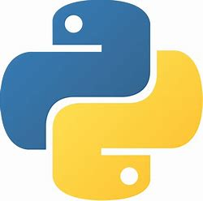

  
  &nbsp;&nbsp;
  

# 🐍 Cours Python — ISI

> **Formateur :** Robert | **Établissement :** ISI (Institut Supérieur d'Informatique)
> **Niveaux :** Licence 1 & Licence 2

Bienvenue dans le dépôt des supports étudiants de Python : cours, ateliers, projets, fichiers de départ et données d'exercice.

## Licence 1 — Bases de Python

### Supports de cours

| # | Chapitre | Support |
|---|---|---|
| 1 | Introduction à Python | [PDF](1-Introduction_Python.pdf) |
| 2 | Bases du langage | [PDF](2-Base_du_langage_python.pdf) |
| 3 | Structures de contrôle | [PDF](3-Structures_de_controle_python.pdf) |
| 4 | Les collections | [PDF](4-Les_collections_en_python.pdf) |
| 5 | Modularité et gestion d'erreurs | [PDF](5-modularite_gesErreur.pdf) |
| 6 | Manipulation de fichiers | [PDF](6-Manipulation_fichiers.pdf) |
| + | Introduction à Tkinter | [PDF](Introduction_tkinter.pdf) |

### Ateliers et projet

| Activité | Support |
|---|---|
| Modularité et erreurs | [PDF](exercices/Atelier_modul_erreur.pdf) |
| Manipulation de fichiers | [PDF](exercices/Atelier_modularite_file.pdf) |
| Tkinter | [PDF](exercices/atelier_tkinter_app.pdf) |
| Projet final | [Énoncé](projets/projet_devoir.md) |

## Licence 2 — Parcours avancés

Deux parcours distincts sont proposés après le Python de L1 :

| Parcours | Contenu | Index |
|---|---|---|
| Python avancé | Fichiers, structures de données, fonctions avancées, générateurs, modularité et introduction à la POO | [Supports, ateliers et fichiers](Python_Avance_L2/README.md) |
| Python pour la science des données | NumPy, pandas, agrégation, exploration et visualisation de données | [Supports, ateliers, notebooks et données](Python_Data_L2/README.md) |

Les dossiers L2 regroupent les versions Markdown et PDF des cours, ainsi que les ressources destinées aux étudiants. Les données WFP du parcours science des données sont attribuées à leur source dans l'index du parcours.

## Autres cours

| Cours | Dépôt |
|---|---|
| Algorithmique | [CoursAlgo](https://github.com/Robsroberto/CoursAlgo) |
| Bases de données | [CoursBD_SGBD](https://github.com/Robsroberto/CoursBD_SGBD) |
| Langage C | [Cours_LangageC](https://github.com/Robsroberto/Cours_LangageC) |
